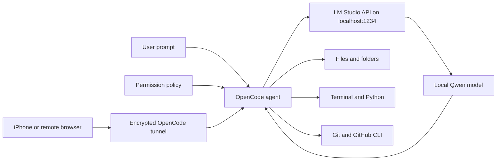

# OpenCode + Local AI

Turn a model running locally in LM Studio into a practical coding agent that can read files, edit projects, execute shell commands, run Python, use GitHub, and work through multi-step tasks.

> Last verified October 27, 2026 on an Apple Silicon MacBook Pro with 24 GB of unified memory, OpenCode 2.2.0, LM Studio 0.4.25+1, and Qwen 3.5 9B.

## Start here

- **New Mac:** use [Automated macOS bootstrap](#automated-macos-bootstrap).
- **LM Studio already installed:** begin with [Step 1](#step-1-start-the-lm-studio-local-api-server).
- **Need the full LM Studio explanation:** read [Complete LM Studio Setup](docs/LM-STUDIO-SETUP.md).
- **Want no approval prompts:** first read [Security and Permission Choices](docs/SECURITY.md), then use the unrestricted template.
- **Want iPhone access:** read [Remote Access and Cloud Operation](docs/REMOTE-AND-CLOUD.md).
- **Something failed:** go directly to [Troubleshooting](docs/TROUBLESHOOTING.md).

## Contents

1. [The core idea](#the-core-idea)
2. [Architecture](#architecture)
3. [Tested local models](#tested-local-models)
4. [Automated macOS bootstrap](#automated-macos-bootstrap)
5. [Manual setup](#step-1-start-the-lm-studio-local-api-server)
6. [Permissions](#step-7-understand-permissions)
7. [GitHub access](#step-8-give-the-agent-github-access)
8. [iPhone and remote access](#step-9-use-opencode-from-an-iphone-or-remote-browser)
9. [Verification](#step-10-run-the-verification-script)
10. [Agent prompt examples](#how-to-use-it-like-claude-code-or-codex)

## The core idea

A language model by itself is like a capable mind in a room with no hands. It can explain what should be done, but it cannot touch the project.

- **The local model is the mind.** Qwen reasons about the request and decides what should happen.
- **LM Studio is the voice connection.** It exposes the model through a local OpenAI-compatible API.
- **OpenCode is the body and hands.** It supplies file, terminal, Git, search, and task-management tools.
- **Permissions are the door locks.** They determine which actions happen automatically, which require approval, and which are blocked.
- **Git is the safety journal.** It records changes so work can be reviewed, compared, and restored.
- **Remote pairing is the remote control.** An iPhone or another computer can operate the OpenCode server that is still running on the Mac.

LM Studio alone is mainly a chat and model-serving application. OpenCode turns the same model into an agent by repeatedly letting it inspect results, choose a tool, act, read the result, and continue until the task is complete.

## Architecture



Prompts and model inference stay local when the LM Studio provider is selected. GitHub operations and remote pairing use the internet because those features contact external services.

## Tested local models

These were downloaded on the reference Mac:

| Model ID | Parameters | Approximate disk size | Suggested role |
|---|---:|---:|---|
| `qwen/qwen3.5-9b` | 9B | 5.98 GB | Default local coding agent |
| `google/gemma-3-12b` | 12B | 8.07 GB | General reasoning and writing |
| `openai/gpt-oss-20b` | 20B | 12.10 GB | Larger local model when memory permits |
| `text-embedding-nomic-embed-text-v1.5` | Embedding model | 84 MB | Retrieval and semantic search, not agent chat |

Model availability, quantization, memory use, and speed vary. A model fitting on disk does not guarantee that every model can remain loaded comfortably at a large context size.

## Repository contents

- `config/opencode.local-models.safe.json`: autonomous development with important guardrails
- `config/opencode.local-models.unrestricted.json`: complete permission bypass
- `scripts/verify-local-stack.sh`: checks the local stack without modifying projects
- `scripts/check-repository.sh`: validates this repository's shell, JSON, links, whitespace, and secret hygiene
- `docs/ARCHITECTURE.md`: how the components communicate
- `docs/LM-STUDIO-SETUP.md`: complete LM Studio installation, model downloads, loading, memory planning, server setup, and API tests
- `docs/REMOTE-AND-CLOUD.md`: iPhone access, remote operation, and true cloud deployment
- `docs/SECURITY.md`: permission and credential risks
- `docs/TROUBLESHOOTING.md`: fixes discovered during setup
- `docs/SESSION-NOTES.md`: sanitized build record and decisions
- `AGENTS.md`: replication instructions for another coding agent

## Prerequisites

- An Apple Silicon Mac for the tested automated path
- Internet access for downloading OpenCode and interacting with GitHub
- Homebrew for fully automated desktop application installation

The manual flow assumes LM Studio and at least one model are already installed. The complete bootstrap can install LM Studio and download the models from a new Mac.

## Automated macOS bootstrap

After cloning this repository, the default bootstrap installs OpenCode from its official source, starts the LM Studio server, backs up any existing OpenCode configuration, replaces the active configuration with the safer local-model template, restarts OpenCode, and verifies the result:

```bash
git clone https://github.com/bhimrajsinghbhuller/opencode-local-ai.git
cd opencode-local-ai
./scripts/bootstrap-macos.sh --desktop
```

For a new Apple Silicon Mac without LM Studio or the models, use the complete setup. The model downloads require roughly 26 GB in the tested variants and may prompt for a format or quantization:

```bash
git clone https://github.com/bhimrajsinghbhuller/opencode-local-ai.git
cd opencode-local-ai
./scripts/bootstrap-macos.sh \
  --install-lm-studio \
  --download-models \
  --desktop
```

If LM Studio shows a first-launch screen and the script cannot yet find `lms`, finish the first launch and rerun the same command. Existing model downloads are detected and skipped.

Complete permission bypass must be requested explicitly:

```bash
./scripts/bootstrap-macos.sh --unrestricted --desktop
```

The repository intentionally does not contain a copy of the OpenCode application or executable. Bundled binaries quickly become outdated, increase repository size, are architecture-specific, and make supply-chain verification harder. The bootstrap retrieves the current release from OpenCode's official installer. The configuration, verification logic, bug fixes, and instructions are version-controlled here.

The bootstrap always saves a timestamped backup before replacing an existing `~/.config/opencode/opencode.json`. If the existing file contains other providers or custom settings, use the manual merge process instead of the bootstrap.

## Step 1: Start the LM Studio local API server

For installation, model-download, quantization, memory, and runtime details, first read [Complete LM Studio Setup](docs/LM-STUDIO-SETUP.md).

In LM Studio, open **Developer** and start the local server. The default address is:

```text
http://127.0.0.1:1234
```

The command-line equivalent is:

```bash
lms server start
lms server status
```

Why this matters: OpenCode cannot communicate directly with a model file. The server translates requests from OpenCode into model inference and returns the model's response.

Official reference: [LM Studio local server](https://lmstudio.ai/docs/developer/core/server)

## Step 2: Load and inspect the local models

List downloaded models:

```bash
lms ls
```

Load Qwen:

```bash
lms load qwen/qwen3.5-9b
```

Check the OpenAI-compatible model endpoint:

```bash
curl -s http://127.0.0.1:1234/v1/models | jq
```

Why this matters: a downloaded model is comparable to a book on a shelf. Loading it places the model into working memory so it can answer requests.

## Step 3: Install OpenCode

Install the OpenCode CLI using the official installer:

```bash
curl -fsSL https://opencode.ai/v2/install | bash
```

Alternatively, use Homebrew:

```bash
brew install anomalyco/tap/opencode-v2
```

Verify it:

```bash
opencode --version
```

Install the desktop application if a graphical interface is preferred:

```bash
brew install --cask opencode-desktop
open -a OpenCode
```

Why this matters: OpenCode is the agent harness. It coordinates the model, tools, permissions, sessions, and project context.

Official reference: [OpenCode installation](https://dev.opencode.ai/v2/docs)

## Step 4: Connect OpenCode to LM Studio

Choose one of the permission templates in this repository. Start with the safer template:

```bash
mkdir -p ~/.config/opencode
cp config/opencode.local-models.safe.json ~/.config/opencode/opencode.json
```

If an OpenCode configuration already exists, merge the `providers` and `permissions` sections instead of overwriting the file.

The essential provider configuration is:

```json
{
  "$schema": "https://opencode.ai/config.json",
  "model": "lmstudio/qwen/qwen3.5-9b",
  "providers": {
    "lmstudio": {
      "name": "LM Studio (local)",
      "package": "@opencode/ai/providers/openai-compatible",
      "settings": {
        "baseURL": "http://127.0.0.1:1234/v1"
      },
      "models": {
        "qwen/qwen3.5-9b": {
          "name": "Qwen 3.5 9B (local)"
        },
        "google/gemma-3-12b": {
          "name": "Gemma 3 12B (local)"
        },
        "openai/gpt-oss-20b": {
          "name": "GPT-OSS 20B (local)"
        }
      }
    }
  }
}
```

Why this matters: `baseURL` is the address of the bridge. The model IDs tell OpenCode what can be selected on the other side of that bridge. No paid API key is required for a local LM Studio endpoint.

OpenCode can discover LM Studio at its default address automatically. This repository keeps an explicit provider and model list so the setup is reproducible, readable, and easy to troubleshoot.

Validate the configuration:

```bash
opencode debug config
opencode models | grep lmstudio
```

Official reference: [OpenCode local models](https://dev.opencode.ai/v2/docs/models/)

## Step 5: Enable the local model in OpenCode Desktop

If the model is configured but does not appear in the normal picker:

1. Open the model picker.
2. Open **Manage Models** using the settings or sliders icon.
3. Find **LM Studio (local)**.
4. Enable the provider.
5. Enable **Qwen 3.5 9B (local)**.
6. Return to the picker and select it.

This hidden-model switch was an important setup detail. A valid provider configuration can exist while the desktop model remains disabled in the visible picker.

## Step 6: Verify local inference

Run a deterministic test:

```bash
opencode run \
  --model lmstudio/qwen/qwen3.5-9b \
  --auto \
  "Reply with exactly: LOCAL_QWEN_OK"
```

Expected output:

```text
LOCAL_QWEN_OK
```

Repeat the same prompt in OpenCode Desktop. A successful response proves this path works:

```text
OpenCode -> localhost:1234 -> LM Studio -> local Qwen -> OpenCode
```

## Step 7: Understand permissions

OpenCode permission rules are ordered. The last matching rule wins.

The recommended policy allows ordinary file operations, shell commands, Python, builds, and tests. It still asks before external-folder access and Git pushes, while blocking `sudo` and `rm -rf`.

```json
"permissions": [
  { "action": "read", "resource": "*", "effect": "allow" },
  { "action": "edit", "resource": "*", "effect": "allow" },
  { "action": "glob", "resource": "*", "effect": "allow" },
  { "action": "grep", "resource": "*", "effect": "allow" },
  { "action": "shell", "resource": "*", "effect": "allow" },
  { "action": "external_directory", "resource": "*", "effect": "ask" },
  { "action": "shell", "resource": "git push *", "effect": "ask" },
  { "action": "shell", "resource": "sudo *", "effect": "deny" },
  { "action": "shell", "resource": "rm -rf *", "effect": "deny" }
]
```

For complete bypass with no approval prompts or configured blocks:

```json
"permissions": [
  { "action": "*", "resource": "*", "effect": "allow" }
]
```

Apply the unrestricted template:

```bash
cp config/opencode.local-models.unrestricted.json ~/.config/opencode/opencode.json
opencode service restart
```

This gives the model every OpenCode action available to the macOS account. It can delete files, access external directories, install software available without administrator authentication, push Git changes, use saved command-line credentials, and run downloaded scripts. Read `docs/SECURITY.md` before enabling it.

Official reference: [OpenCode permissions](https://dev.opencode.ai/v2/docs/permissions)

## Step 8: Give the agent GitHub access

Install GitHub CLI:

```bash
brew install gh
```

Authenticate in the browser:

```bash
gh auth login
gh auth status
```

Clone and open a repository:

```bash
gh repo clone OWNER/REPOSITORY
cd REPOSITORY
opencode .
```

Example prompt:

```text
Inspect this repository. Read its documentation and tests, explain its architecture,
run the test suite, fix the failing tests, show me the diff, commit the verified
changes on a new branch, and open a pull request.
```

Why this matters: OpenCode does not need a special GitHub model connection. It uses the same `git` and `gh` tools a developer would use. The authenticated GitHub CLI supplies repository access.

## Step 9: Use OpenCode from an iPhone or remote browser

Enable OpenCode's encrypted remote tunnel:

```bash
opencode service set remote true
opencode service start
opencode pair --remote
```

Open the one-time link on the iPhone. The link works once and expires after five minutes. In Safari, use **Share > Add to Home Screen** for app-like access.

The paired browser controls the OpenCode server on the Mac. The Mac must remain awake, connected to the internet, and running OpenCode and LM Studio with the model loaded.

If the first remote pairing attempt remains at `Setting up remote access`, see `docs/TROUBLESHOOTING.md`.

Official reference: [OpenCode web and remote access](https://dev.opencode.ai/v2/docs/cli/web)

## Step 10: Run the verification script

```bash
./scripts/verify-local-stack.sh
```

The script checks:

- LM Studio CLI availability
- LM Studio server status
- OpenAI-compatible API reachability
- Installed local model IDs
- OpenCode installation and configuration
- Visibility of the LM Studio models
- Git and optional GitHub authentication

It does not edit projects or change permissions.

## How to use it like Claude Code or Codex

Open the actual project directory before prompting the agent. Give it an outcome and verification criteria, not only an isolated coding instruction.

Good prompt:

```text
Build a small Python command-line task manager in this folder. Use SQLite,
include tests, run the tests, fix all failures, and write a concise README.
Do not stop at an explanation. Create and verify the working files.
```

Repository task:

```text
Create a branch named fix/login-timeout. Reproduce the timeout bug, identify the
root cause, implement the smallest safe fix, add a regression test, run the full
test suite, review the diff, commit it, and open a GitHub pull request.
```

Research-first task:

```text
Inspect the repository and propose a plan before editing. Identify risky areas,
existing conventions, and the exact tests that should prove the change works.
Then implement and verify the plan.
```

## Local does not mean unlimited capacity

Local inference has no per-token provider bill and no external provider rate limit. It is still limited by:

- Unified memory and available RAM
- Model size and quantization
- Context length
- Generation speed
- Battery and thermal limits
- The model's reasoning and tool-use quality

OpenCode models labeled **Free** are cloud-hosted services. Free pricing does not guarantee unlimited use. Capacity limits and rate limits can change. Local LM Studio models are the option that avoids provider token charges.

## Privacy boundaries

With the local provider selected, prompts sent for inference remain on the Mac. Data can still leave the Mac when the agent is instructed or permitted to use:

- GitHub
- Web search or web requests
- Package managers
- Remote MCP servers
- OpenCode remote pairing
- Any shell command that contacts an internet service

Local inference and total offline operation are related but not identical.

## Official references

- [OpenCode documentation](https://dev.opencode.ai/v2/docs)
- [OpenCode local models](https://dev.opencode.ai/v2/docs/models/)
- [OpenCode permissions](https://dev.opencode.ai/v2/docs/permissions)
- [OpenCode web and remote access](https://dev.opencode.ai/v2/docs/cli/web)
- [LM Studio local server](https://lmstudio.ai/docs/developer/core/server)
- [LM Studio tool use](https://lmstudio.ai/docs/developer/openai-compat/tools)
- [LM Studio offline operation](https://lmstudio.ai/docs/app/offline)

## License

MIT. See `LICENSE`.
